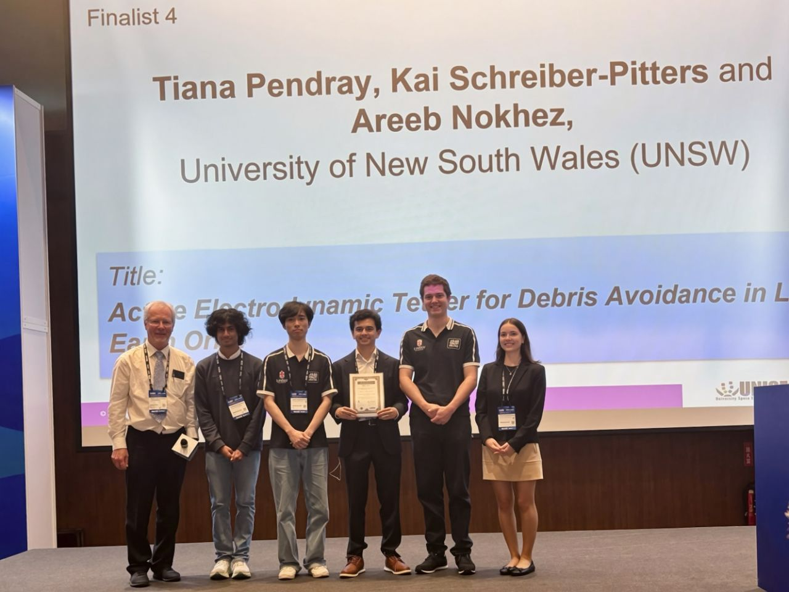

Congratulations to AUStornauts VIP team members [Tiana Pendray](https://www.linkedin.com/in/tiana-pendray1/), [Kai Schreiber-Pitters](https://www.linkedin.com/in/kai-schreiber-pitters-493383265/), [Areeb Nokhez](https://www.linkedin.com/in/areeb-nokhez-149a2b303/), [Jaden Ann](https://www.linkedin.com/in/jaden-ann/) and [Dhiren Perera](https://www.linkedin.com/in/dhiren-perera-a15182311/), who won third place at the 10th Mission Idea Contest in Taiwan on 9 November.

Their idea, **“Active Electrodynamic Tether for Debris Avoidance in Low Earth Orbit,”** offers a creative approach to addressing the challenge of space debris.

> “I am incredibly proud of this achievement and grateful for the support provided by the Faculty and School. I look forward to working with the team as we pursue new milestones and opportunities, including launching our CubeSat into orbit,” said Professor [Yang Y.](https://www.linkedin.com/in/yang-yang-space/), the project’s academic lead.

Congratulations to the whole team on this fantastic achievement! 🎉

[Read more about the contest](https://lnkd.in/gawUiy_w).

