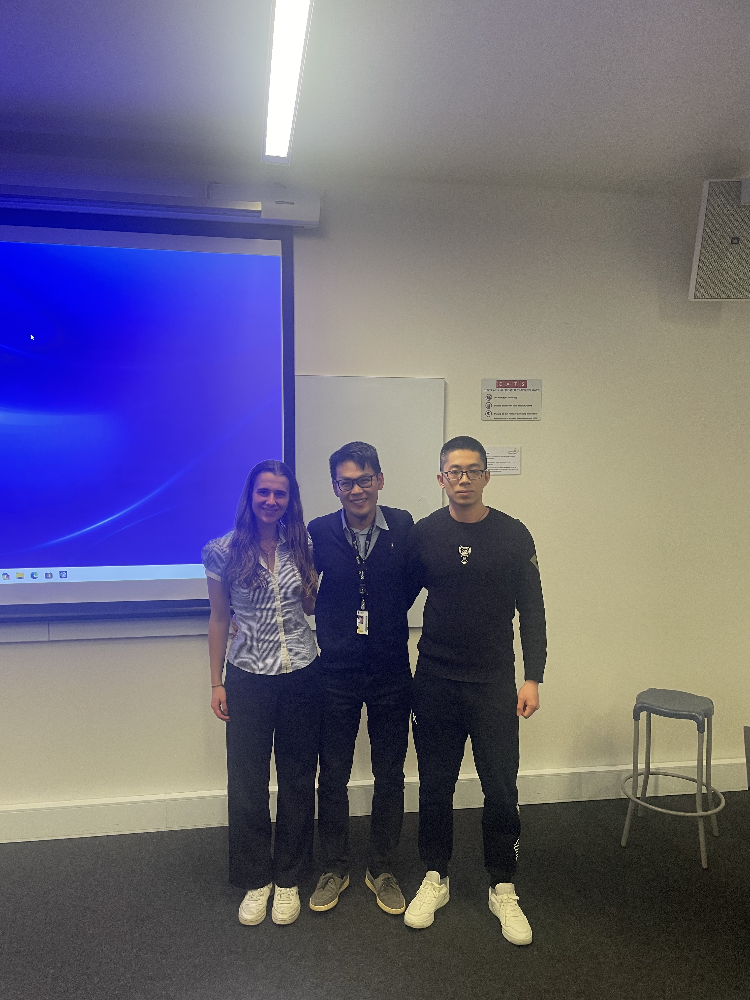

Congratulations to **Darcy Faulkes** and **Tao Zhang** on completing their thesis projects under my supervision.

Darcy, an undergraduate student, presented her work titled **Remote and Autonomous Control of a Legacy Observatory: A Modular Software Architecture for Satellite Tracking at the UNSW Observatory**.

Tao, a postgraduate student, presented his work titled **Inferring GEO Satellite Pattern of Life Using Transformers**.

Best of luck to Darcy and Tao in their future endeavours!

