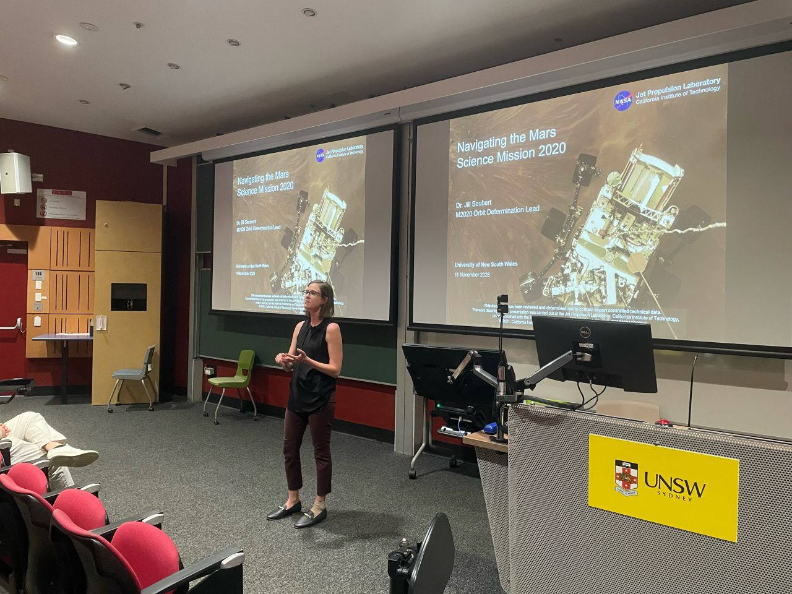

It was a pleasure to welcome [Dr Jill Seubert](https://www.linkedin.com/in/jill-seubert-8891977/) to UNSW Sydney for an invited lecture with our AERO9500 satellite orbit students.

I often tell my students that what we learn in class has real mission applications. Jill brought this to life, showing how fundamental concepts such as the Hohmann transfer are applied in Mars missions.

Drawing on her experience as a deep-space navigator at NASA’s Jet Propulsion Laboratory, including the Mars 2020 Perseverance mission, Jill shared fascinating insights into real-world space navigation.

Now at Optus Satellite and founder of Australis Space Navigation, Jill also sparked exciting discussions about potential university–industry collaboration in GEO orbit estimation and cislunar navigation.

Many thanks to Jill for such an informative and inspiring visit!
