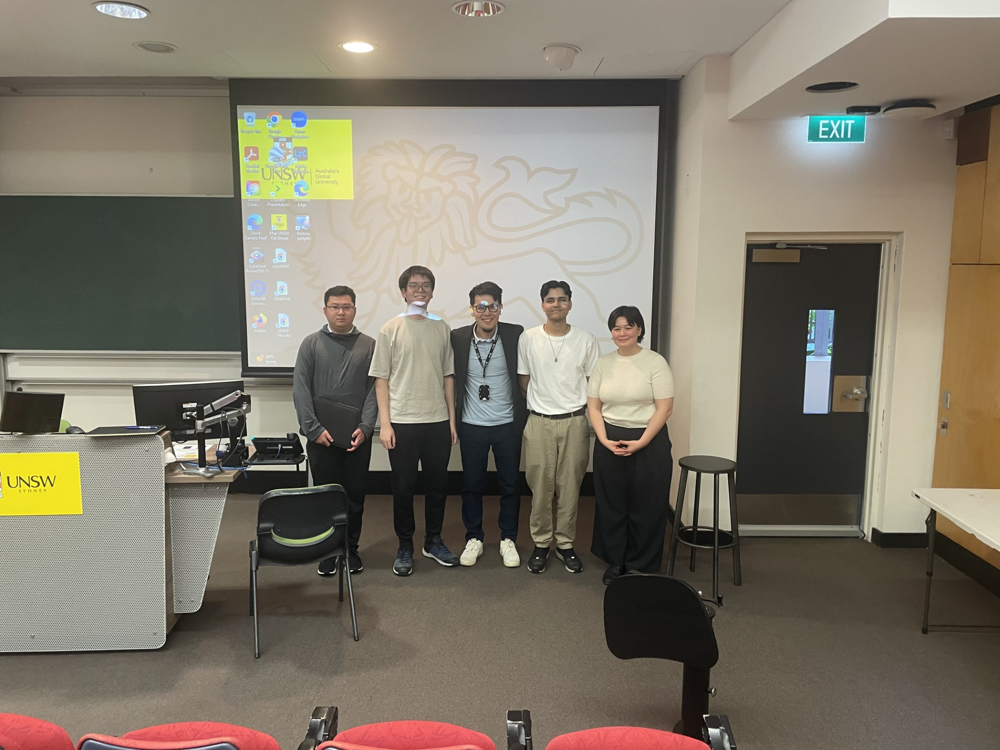

Four undergraduate thesis students successfully completed their final thesis presentations on 25 April, marking the conclusion of a one-year project journey under my supervision.

Over the past year, each student demonstrated strong commitment, technical growth, and professionalism throughout their project work. The final presentation session highlighted the quality of their outcomes and their ability to communicate research and engineering ideas clearly.

## Students and Projects

- **Asad Rizvi** – Factor Graph Optimisation for Satellite Orbit Determination: Gaussian Approximation Methods for Impulsive Manoeuvre Modelling

- **Justin Kwok** – End-to-end Pipeline for Astrometric Analysis of Satellite Streak Images

- **Siena Seeto** – Comparison of BVP energy metric association methods for maneuvering and clustered satellites

Congratulations to all students on this important milestone!

