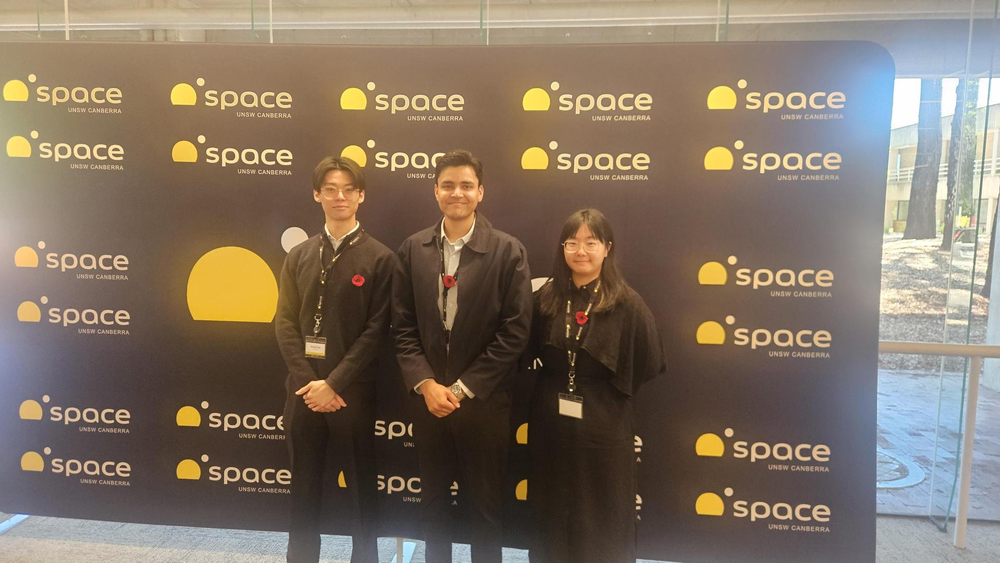

**Yuting (Angela) Ng**, **Michael Ling** and **Asad Rizvi** attended the
[2026 Australian Space Domain Awareness and Space Traffic Management Conference](https://conference.unsw.edu.au/en/2026-australian-space-domain-awareness-space-traffic-management-conference),
held **10–12 November** at UNSW Canberra.

The three attendees bring complementary work in space object characterisation and optical space
surveillance:

- **Yuting (Angela) Ng** is researching a range/range-constrained admissible-region approach to GEO
  tracklet-to-orbit association for her Honours thesis, and presented this work at the conference.
  Read more about the work in the
  [space-object-characterisation project](/project/space-object-characterisation/) and view her
  [conference presentation deck (PDF)](/slides/Range_Range_Constrained_Admissible_Region_GEO_Angela_Ng.pdf).
- **Michael Ling** presented the Optical Pattern of Life Analysis Library (OPAL), which investigates
  time-series models for classifying satellite patterns of life from optical observations. See the
  [space-object-characterisation project](/project/space-object-characterisation/) and
  [OPAL presentation deck (PDF)](/slides/OPAL_Michael_Ling_ASDA_STM_2026.pdf).
- **Asad Rizvi** is developing satellite photometry and polarimetry for space-object characterisation
  using the UNSW telescope. Explore his work in the
  [optical tracking and observatory automation project](/project/optical-tracking/).

We enjoyed sharing our work and connecting with the Australian space community.
