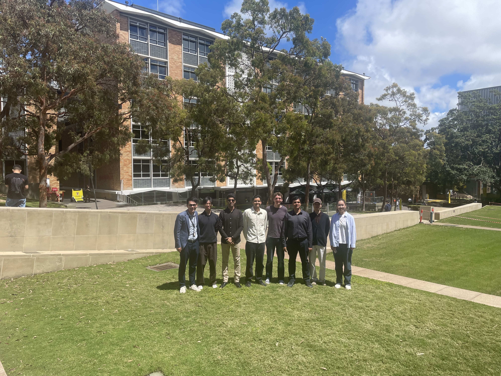

On 21 October, our group came together for a research presentation session followed by lunch. The talks covered a broad range of topics, including atmospheric density modelling and estimation, lunar orbit determination and time synchronisation, and geostationary pattern-of-life characterisation. Congrats to all students and researchers for their solid progress!

It was a great opportunity to share ideas across projects, learn more about one another’s work, and enjoy some time together as a group.

